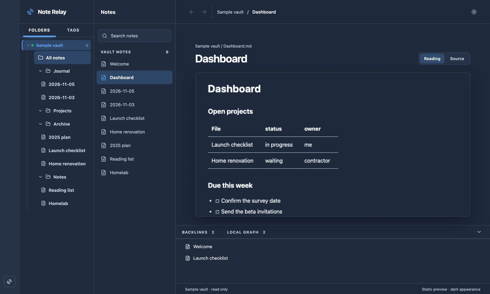
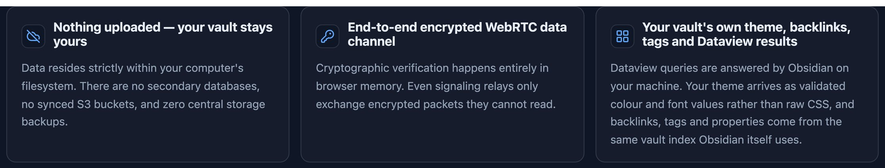

# Note Relay

Read and edit an Obsidian vault from a browser, without uploading the vault anywhere.

Note Relay is an Obsidian desktop plugin paired with a browser viewer at [noterelay.io](https://noterelay.io).
The browser talks to the live vault over an authenticated WebRTC data channel, with an encrypted relay used
only when a direct connection cannot be established. Markdown, rendered Dataview results and images travel
over that channel — the Note Relay service stores account, host, pairing and authorization records, not note
bodies.

## Why this exists

Obsidian has no web app. The usual answer is to export notes into a published site, which leaves behind what the
vault actually does: Dataview queries, backlinks, and edits that come back.

Note Relay connects a browser to the vault running on your desktop. A Dataview table renders the way it does in
Obsidian, because Obsidian renders it; a save lands in the same Markdown file, and carries the content hash it
was based on so a concurrent edit is reported as a conflict rather than overwritten. Nothing is uploaded: notes
travel over an authenticated, encrypted connection between your browser and your machine, and the service keeps
account, pairing and authorization records rather than note bodies.

**Note Relay is in private beta.** Accounts are invite-only — request access at [noterelay.io](https://noterelay.io).

## Foundational guarantees

| Nothing uploaded — your vault stays yours | End-to-end encrypted channel | Your vault does the rendering |
| --- | --- | --- |
| Data stays on your computer's filesystem. There is no secondary database, no synced bucket and no central backup. | Keys are negotiated between the browser and the vault. A relay only ever carries packets it cannot read. | Dataview, maths, Mermaid and your theme are computed by Obsidian. The browser receives finished, sanitised output. |

**Reading is free. Editing is the paid part.** A vault you have paired is yours to read for as long as you
want, at no cost. Writing to it is what the paid plan buys.

## What it does

- Lists your vault, opens notes, and renders them with headings, links, embeds, maths and Mermaid diagrams.
- Renders Dataview tables, lists and task queries **in Obsidian itself**, then sends the result — the browser
  never runs Dataview and never receives your Dataview JavaScript.
- Shows tags, backlinks and a one-hop local graph for the open note.
- Applies your vault's theme as a set of validated colour and font tokens, so the browser view follows your
  theme without loading your CSS.
- Searches note text on your machine and returns titles, match counts and short excerpts; the note body is
  fetched only when you open a result.
- With a paid subscription: saves notes, creates, renames, moves and deletes them. Every save and delete
  carries the content hash it was based on, so an edit made in Obsidian in the meantime is reported as a
  conflict instead of being overwritten.

## How it works

1. **Install the plugin** — Settings → Community plugins → Browse, search for Note Relay, then Install.
2. **Pair the vault** — approve the same fingerprint on the vault and in the browser. From then on the browser
   may ask that vault for notes, and nothing else.
3. **Open a browser anywhere** — your vault appears as a folder tree, and reading behaves like Obsidian.

> The vault has to be awake and hosting. If your computer is asleep or the plugin is off, the browser cannot
> reach it. That is a real limitation of how this works, not a bug we are pretending away.

## Security: the path a note takes

1. Your browser connects to your vault on the strength of a short-lived signed grant. The grant names the
   vault and nothing else — not a note, not a path.
2. You click a note. That request travels over the channel to the plugin, so the note you opened is never
   named to us.
3. The plugin reads the note from your own disk and renders it on your own machine.
4. The result comes back over the same encrypted channel. Nothing is written to a server on the way.

> **After step 1, we are out of the picture.** All we do is establish the connection: introduce your browser
> to your vault, then get out of the way. Nothing is stored for us to lose, and nothing to hand over if we were
> asked. That is also why your vault has to be awake — there is no copy of it anywhere else to fall back on.

## Free to read, paid to edit

| Free | Base |
| --- | --- |
| Read any paired vault from any browser | Everything in Free |
| Folders, tags, backlinks and the local graph | Edit notes: create, rename, move, delete, save |
| Dataview, properties, callouts, code with a copy button | Tick checkboxes and edit properties |
| Reading stays free | Conflicts refused, never merged |

Editing is the paid plan. There is no charge for reading, and no card is required for it. Current plans and
prices are on [noterelay.io](https://noterelay.io) — this repository does not state prices.

## Disclosures

- **An account is required.** Reading or editing a vault from a browser both go through a Note Relay account.
  You sign in at [noterelay.io](https://noterelay.io), pair this vault with your account, and approve the
  pairing in the browser with the host key fingerprint the plugin shows you. Hosting starts off: nothing is
  opened until you turn it on.
- **Payment is required for editing.** Reading your own vault from a browser is free. Saving, creating,
  renaming, moving and deleting notes requires a paid Note Relay subscription. Current plans and prices are on
  [noterelay.io](https://noterelay.io); this repository does not state prices. During the beta, accounts are
  invite-only — request access on the site.
- **Network use.** See [Network use](#network-use) below for what the plugin contacts and why.

## Requirements

- Obsidian 1.10.0 or later, desktop only (Windows, macOS, Linux).
- A Note Relay account.
- The computer holding the vault awake and hosting while you read it.

## Install

1. In Obsidian, open **Settings → Community plugins → Browse** and search for **Note Relay**.
2. Select **Install**, then **Enable**.

## Network use

Every request below is made by the plugin from your machine. There is no analytics or telemetry of any kind.

- **`api.noterelay.io`** — pairing, host presence, signalling and short-lived relay credentials. It sees your
  account id, vault id, connection timing and your IP address. It never receives note content.
- **`noterelay.io`** — the site, the plugin download, and one version check that raises an "update available"
  notice.
- **An encrypted relay (Cloudflare TURN)**, used only when a direct connection cannot be established. It
  carries encrypted traffic and connection metadata, and never holds keys.

Signalling sees connection metadata but not note content: notes travel peer-to-peer, and the relay forwards
encrypted traffic without keys. Cloudflare's logging and retention for the relay are outside Note Relay's
control; the privacy policy at [noterelay.io/privacy](https://noterelay.io/privacy) states what Note Relay
itself keeps.

## Limits worth knowing

- The browser view is not pixel-identical to Obsidian. Preview is rendered from a standalone Markdown parser,
  not Obsidian's own view.
- Inline images are limited to PNG, JPEG, GIF and WebP rasters, size-capped per image.
- Arbitrary vault CSS is not loaded; only validated theme tokens are sent.
- The local graph is a one-hop slice around the open note, not the full vault graph.
- Search covers note text on the host; attachments and PDFs are not searched.
- One reader per vault at a time: a second device is offered a deliberate takeover rather than a silent
  conflict.

## Report a problem

Open an issue on this repository, or email [support@noterelay.io](mailto:support@noterelay.io) if the report
involves vault content or credentials — please do not paste note text into a public issue.

## License

MIT — see [LICENSE](LICENSE).
